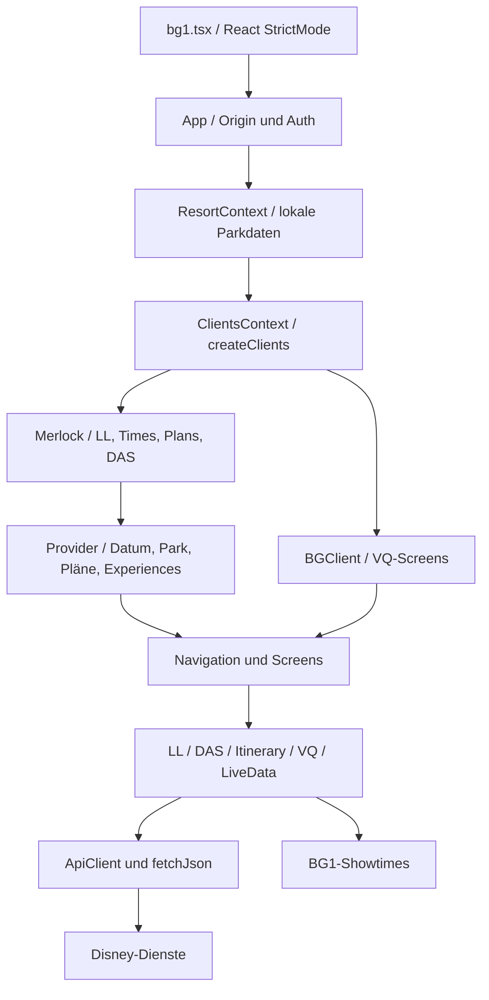

# Architektur

## 1. Betriebsmodell und Einstieg

[bg1.tsx](../src/bg1.tsx) wartet auf `document.body`, schließt das Dokument,
ergänzt Viewport und Favicon und hängt einen React-Root an den vorhandenen Body.
Die App läuft in `StrictMode`. Das ist ein Skript-Einstieg für eine bestehende
Browserseite, kein klassisches Repository mit eigener `index.html` als App-Start.
Ein eventuell vorhandener Body-Inhalt wird dabei nicht explizit gelöscht.

[App.tsx](../src/components/App.tsx) bestimmt den Modus anhand des tatsächlichen
Browser-`origin`, unabhängig davon, von wo die JavaScript-Datei geladen wurde:

| Origin                                        | Resort | Oberfläche                                   |
| --------------------------------------------- | ------ | -------------------------------------------- |
| `https://disneyworld.disney.go.com`           | WDW    | `Merlock`: LL-Daten, Times Guide, Plans, DAS |
| `https://disneyland.disney.go.com`            | DLR    | `Merlock`                                    |
| `https://vqguest-svc-wdw.wdprapps.disney.com` | WDW    | `BGClient`: virtuelle Warteschlangen         |
| `https://vqguest-svc.wdprapps.disney.com`     | DLR    | `BGClient`                                   |
| Sonstiger Origin                              | keiner | Weiterleitung auf die externe BG1-Startseite |

Die App versucht zuerst `LLClient.originToResortId`, dann die VQ-Variante.
Nach erfolgreicher Zuordnung lädt sie statische Resortdaten dynamisch,
setzt die Parkzeitzone und erzeugt die Clients. WDW verwendet
`America/New_York`, DLR `America/Los_Angeles`.

Die sichtbare Priorität ist: Disclaimer → News → Login → Fachoberfläche.
`NEWS_VERSION` ist aktuell `0`; die News-Funktion ist vorhanden, aber initial
nicht als neue Version aktiviert. Beim Zurückkehren in einen sichtbaren Tab
wird die Gültigkeit der Authentifizierung erneut geprüft.



## 2. Verzeichnisstruktur

| Pfad                                                     | Aufgabe                                                                |
| -------------------------------------------------------- | ---------------------------------------------------------------------- |
| `src/api/`                                               | Auth, API-Basisklasse, LL, DAS, VQ, Reiseplan, Showzeiten, Avatare     |
| `src/api/ll/`                                            | WDW- und DLR-spezifische LL-Protokolle                                 |
| `src/api/data/`                                          | Statische Parks, Lands, Experiences, Prioritäten und Dropzeiten        |
| `src/contexts/`                                          | Typisierte React-Schnittstellen für geteilten Zustand                  |
| `src/providers/`                                         | Initialisierung und Aktualisierung dieses Zustands                     |
| `src/components/ll/`                                     | Datenlisten, Tagesplan, LL- und DAS-Bedienabläufe                      |
| `src/components/vq/`                                     | Queue-Auswahl, Gästeauswahl, Join und Ergebnis                         |
| `src/hooks/`                                             | Loader, Flash, Throttling, gespeicherte Party, Standort, Screenzustand |
| `src/icons/`                                             | JSX-/SVG-Icons                                                         |
| `src/__fixtures__/`, `src/__mocks__/`, `src/testing.tsx` | Testszenarien, Mocks, UI-Testhilfen                                    |
| `tls/`                                                   | Zertifikat und Schlüssel für den lokalen HTTPS-Server                  |

Runtime-Abhängigkeiten laut Manifest: React und React DOM 19. Die übrigen
Pakete bilden TypeScript-, Vite-, Tailwind-, Jest-, ESLint- und Formatierungswerkzeuge.

## 3. Clients und ihre Kopplung

[createClients](../src/contexts/ClientsContext.ts) erzeugt pro Resort:
`DasClient`, `ItineraryClient`, `LiveDataClient`, `VQClient` sowie
`LLClientWDW` oder `LLClientDLR`.

`itinerary.onRefresh = bookings => ll.track(bookings)` koppelt neue Plandaten
an die Erkennung bereits genutzter LL-Experiences. Dieser Aufruf wartet nicht
auf das asynchrone Tracking. Eine erfolgreiche Planaktualisierung bedeutet
deshalb nicht, dass Tracking und Speicherung bereits beendet sind.

`ApiClient` ist der gemeinsame authentifizierte Transport; `LiveDataClient`
nutzt direkt `fetchJson` und benötigt keine Disney-Auth. VQ überschreibt die
Origin-Tabelle, LL erweitert Requests bei Bedarf um `userId`.

## 4. Provider und Lebenszyklus

Die Reihenfolge in [Merlock](../src/components/ll/Merlock.tsx) bildet echte
Abhängigkeiten ab:

```text
DasPartiesProvider
└─ PlansProvider
   └─ BookingDateProvider
      └─ ParkProvider
         └─ ExperiencesProvider
            └─ RebookingProvider
               └─ NavProvider
                  └─ Home
```

| Provider              | Verhalten                                                                                                                  |
| --------------------- | -------------------------------------------------------------------------------------------------------------------------- |
| `DasPartiesProvider`  | Lädt DAS-Partys beim Mount; `RequestError` wird still ignoriert, andere Fehler werden im asynchronen Effect weitergeworfen |
| `PlansProvider`       | Lädt normalisierte Buchungen; hält `plansLoaded` und Refreshfunktion                                                       |
| `BookingDateProvider` | Heute oder, bei `prebook`, ein gültiger Tag aus 22 Tagen einschließlich heute                                              |
| `ParkProvider`        | Gespeicherter Tagespark; andernfalls Initialisierung nach dem Laden der Pläne                                              |
| `ExperiencesProvider` | Lädt Tipboard und ergänzende Shows; löscht Liste bei Park-/Datumwechsel                                                    |
| `RebookingProvider`   | Aktuelle LL und Kennzeichen für automatisch begonnene Umbuchung                                                            |
| `NavProvider`         | In-Memory-Screenstack, gekoppelt an numerischen URL-Hash                                                                   |

`Home` besitzt Tabs `LL`, `Times`, `Plans`. Rückkehr in einen sichtbaren Tab
aktualisiert Experiences und Pläne bei aktivem Home-Screen und mindestens
60 Sekunden seit dem letzten Refresh. Das ist kein periodischer Poller.
VQ aktualisiert die Queue-Liste beim Sichtbarwerden ohne dieses 60-Sekunden-Limit.

## 5. Domänenmodell

`Resort` verbindet Park → Land → Experience. Die Konstruktion ergänzt
IDs, Theme-Objekte und `ParkTime`-Dropzeiten direkt in den importierten
Datenobjekten; diese werden mutiert, nicht vollständig kopiert.

`Experience` verbindet statische Eigenschaften wie Name, Kategorie, Priorität
und Geokoordinaten mit Tipboard-Daten wie Standby, Flex, Single Pass und VQ.
Ein `Offer` ist ein Buchungsangebot mit Start/Ende, Gästen, Experience,
gegebenenfalls bestehender Buchung, Itinerary-Konflikten und Parkstunden.
Es ist noch keine bestätigte Buchung.

[itinerary.ts](../src/api/itinerary.ts) verwendet eine diskriminierte Union:

| Typ   | Bedeutung                 | Wichtige Besonderheit                                                         |
| ----- | ------------------------- | ----------------------------------------------------------------------------- |
| `LL`  | Lightning Lane            | `MP`, `SP`, `OTHER`; nur MP wird als änder-/stornierbar übernommen            |
| `DAS` | Disability Access Service | `IN_PARK` oder `ADVANCE`; nur In-Park stornierbar                             |
| `RES` | Dining oder Activity      | Zeitangabe, Anzeige; keine Buchung in BG1                                     |
| `BG`  | Boarding Group            | Gruppennummer und Status, Startdatum ohne Rückkehrzeit                        |
| `APR` | Park Pass                 | Datum; beeinflusst Parkauswahl, wird aus eigentlichen Planlisten ausgeblendet |

## 6. Persistenz

`kvdb` ist ein dünner JSON-Wrapper um **originbezogenen `localStorage`**.
Die unterschiedlichen Betriebsorigins teilen keinen gemeinsamen Speicher.
`getDaily` akzeptiert einen Wert nur, wenn sein gespeichertes Datum dem
aktuellen `parkDate()` entspricht; veraltete Einträge werden nicht gelöscht.

| Schlüssel                                     | Inhalt / Lebensdauer                                             |
| --------------------------------------------- | ---------------------------------------------------------------- |
| `bg1.auth`                                    | SWID, Bearer-Token, Ablaufzeit; ohne zusätzliche Verschlüsselung |
| `bg1.park`, `bg1.date`                        | Tagesgültige Park-/Datumsauswahl                                 |
| `bg1.ll.bookings`                             | Tagesgültige Sets gebuchter und genutzter Experiences            |
| `bg1.genie.partyIds`                          | Gespeicherte Gästeauswahl                                        |
| `bg1.genie.sort`                              | Sortierung                                                       |
| `bg1.genie.tipBoard.starred`                  | Favoriten                                                        |
| `bg1.ll.fullAvailability`                     | Auswahl der erweiterten Zeitanzeige                              |
| `bg1.tab`                                     | Zuletzt gewählter Home-Tab                                       |
| `bg1.disclaimer.accepted`, `bg1.news.version` | Disclaimer und Newsstand                                         |
| `bg1.ping.<Resort>.<D/G/V>`                   | Zuletzt erfolgreich gemeldetes Kalenderdatum                     |

Logout löscht `bg1.auth`, aber nicht sämtliche Präferenzen und Gäste-IDs.
Die allgemeine `kvdb.clear()`-Methode würde den ganzen Speicher des Origins
löschen, nicht ausschließlich BG1-Schlüssel.

## 7. Externe Abhängigkeiten und Vertrauensgrenzen

| Dienst                                       | Verwendung                                       |
| -------------------------------------------- | ------------------------------------------------ |
| Disney Resort-/VQ-Origins                    | Authentifizierte Fach-API-Requests               |
| `cdn.registerdisney.go.com/v4/OneID.js`      | Nachgeladenes Login-SDK                          |
| `joelface.github.io/bg1/responder.html`      | OneID-Responder                                  |
| `joelface.github.io/bg1/start.html`          | Weiterleitung bei unbekanntem Origin             |
| `bg1.joelface.com/livedata/…/showtimes.json` | Ergänzende Showzeiten                            |
| `bg1.joelface.com/t`                         | Serverzeit im Header `T`                         |
| `bg1.joelface.com/ping`                      | Nutzungsereignis nach erfolgreicher D/G/V-Aktion |
| Disney-CDN für Avatare                       | Anzeige bekannter Character-IDs                  |
| Browser-Geolocation                          | Optionale Nearby-Sortierung                      |

Die im Ping-Body explizit versendeten Daten sind Resort und Servicecode.
Standortdaten werden im untersuchten Code lokal zur Sortierung genutzt und
nicht ausdrücklich an den Ping-Dienst übertragen. Transport-/Browsermetadaten
sind damit nicht ausgeschlossen.

Der Responder beantwortet bestimmte `postMessage`-Ereignisse mit einem ACK
und quittiert `CALL`-Nachrichten über einen MessagePort mit `data: null`.
Er enthält keinen eigenen Auth- oder Buchungsserver. Origin und Nachrichtenform
werden dort nicht überprüft; Details zu diesem Befund stehen in
[BEFUNDE.md](BEFUNDE.md).
