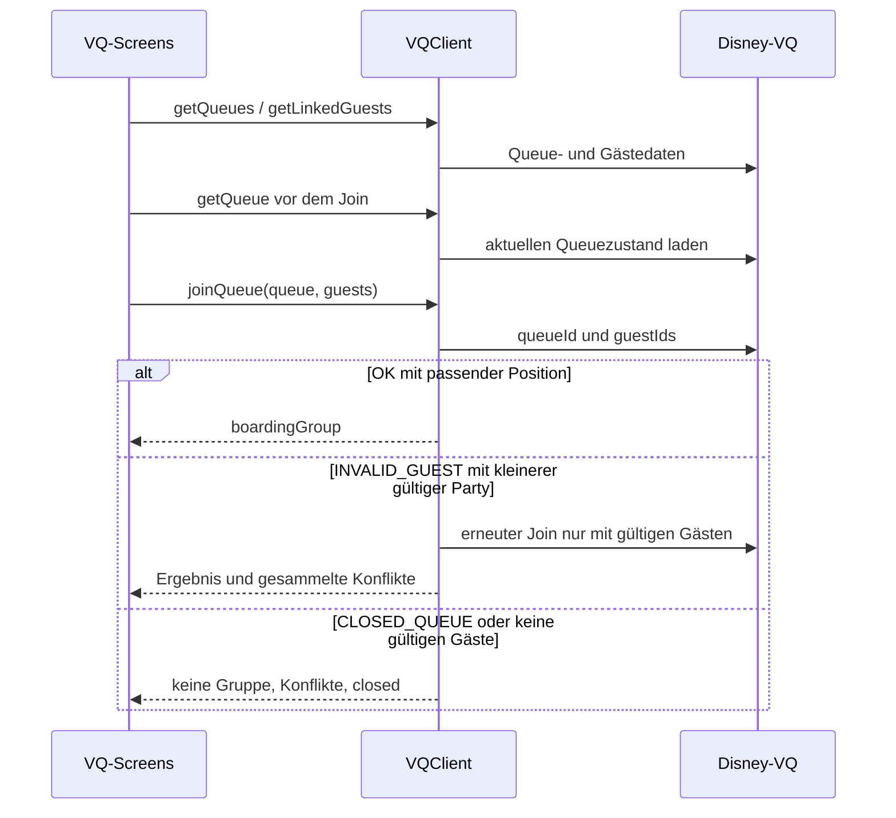

# Tiefe Funktionsanalyse

Diese Analyse beschreibt den Quelltextstand des Forks, einschließlich
deaktivierter LL-Pfade. Die Referenzen führen zu den Implementierungen.
Reale Erreichbarkeit der externen APIs wurde nicht getestet.

## 1. Authentifizierung und Transport

### `OneId` und `LoginForm`

[LoginForm.tsx](../src/components/LoginForm.tsx) rendert keine eigene Loginmaske.
Ein Effect lädt das Disney-OneID-Skript und öffnet dessen Dialog.

1. `loadClient(resortId)` lädt das Skript nur einmal pro Dokument.
2. Auf `self.OneID` und bei parallelen Aufrufen auf den statischen Client wird
   in 100-ms-Schritten gewartet.
3. Die Client-ID lautet `TPR-<Resort>-LBSDK.<AND|IOS>`; jeder nicht als Android
   erkannte User-Agent verwendet `IOS`.
4. `OneID.get` erhält diese Client-ID und die externe Responder-Seite.
5. Nach `init()` wird ein SDK-eigener Guest-Speichereintrag entfernt.
6. `launchLogin` ersetzt bestehende eigene `login`-/`close`-Listener;
   Schließen öffnet den Dialog erneut.
7. Das Login-Event liefert SWID, Access-Token und Ablaufdatum an `App`.
8. Beim Unmount entfernt `LoginForm` den Wrapper des Dialogs; SDK-Listener
   werden dabei nicht vollständig abgemeldet.

Es gibt weder ein Zeitlimit für das Warten auf SDK/Client noch einen
Script-`onerror`-Pfad. Netzwerkfehler können deshalb zu dauerhaftem Warten
führen. Der statische Client wird zudem nicht anhand eines neuen Resorts
neu erzeugt; der gewöhnliche Originwechsel erzeugt allerdings ein neues Dokument.

### `AuthStore.getData`, `setData`, `deleteData`

[auth.ts](../src/api/auth.ts) liest `bg1.auth` aus `localStorage` und akzeptiert
den Eintrag nur, wenn seine Ablaufzeit in der Zukunft liegt **und** entweder
das Ablaufdatum nach heute liegt oder die Ablaufuhrzeit mindestens 17:00 beträgt.
Ein Token mit Ablauf heute um 16:59 wird somit auch um 12:30 abgewiesen.
Dies ist eine zusätzliche Anwendungsregel, nicht bloß ein normaler Ablaufcheck.

`DateTime`-Objekte werden hier mit `>` verglichen. Da `DateTime` keine eigene
numerische `valueOf`-Methode besitzt, erfolgt für diese Objekte der Vergleich
über ihre ISO-artige Stringdarstellung. Bei gültigen normalisierten Daten ist
die lexikografische Reihenfolge brauchbar; `Number(DateTime)` ist dagegen `NaN`.

Fehlende/ungültige Daten werden gelöscht, `onUnauthorized` wird per Timer
aufgerufen, anschließend wird `ReauthNeeded` geworfen. `setData` speichert
ohne Schemaüberprüfung. Logout ist nur das Löschen dieses Auth-Eintrags;
eine serverseitige Tokenwiderrufsfunktion ist nicht implementiert.

### `ApiClient.request`

[client.ts](../src/api/client.ts) führt für jeden Request diese Schritte aus:

1. Instanzbezogenes `RateLimit(5)` erzwingen.
2. SWID und Token lesen; ohne gültige Auth kein Netzwerkrequest.
3. Resort-Origin und Pfad kombinieren.
4. `fetchJson` mit `Accept-Language`, Bearer-Token und `x-user-id` aufrufen.
5. Bei HTTP 401 Auth asynchron löschen, außer `ignoreUnauth` ist gesetzt.
6. Bei Erfolg optional `data[key]` extrahieren; der Wert muss truthy sein.
7. In allen übrigen Fällen `RequestError` mit kompletter Response werfen.

Die Option `key` ist kein Laufzeitschema. `false`, `0`, leere Strings und
`null` gelten damit als fehlerhafte Ergebnisse, während leere Arrays/Objekte
akzeptiert werden. `RequestError` serialisiert die Response in die Fehlermeldung;
Logs können deshalb personenbezogene Antwortdaten enthalten.

### `fetchJson` und Kurzzeit-Deduplizierung

[fetch.ts](../src/fetch.ts) ergänzt Queryparameter, serialisiert ein truthy
`data` als JSON, setzt dann standardmäßig POST, ansonsten GET. Defaults:
`credentials: omit`, `cache: no-store`, leerer Referrer, Timeout 8 Sekunden.
Netzwerk-/Abortfehler ergeben `{ok:false,status:0,data:null}`.
Nicht als `application/json` deklarierte Antworten ergeben `data: {}`.
Fehler beim JSON-Parsen werden nicht in dieses Status-0-Ergebnis umgewandelt.

Das Timeout endet nach `fetch()` und deckt das anschließende `response.json()`
nicht mehr ab. Ein übergebener Abort-Signal wird durch den internen Controller
ersetzt. Der Cache hält Promises für 10 ms ab Requeststart, nicht bis zum Ende
eines Requests. Seine Identität besteht nur aus HTTP-Methode plus URL.
POST-Body, Header und Benutzeridentität fehlen im Schlüssel.

**Folge:** Zwei unterschiedliche POST-Aktionen gegen denselben Pfad innerhalb
von 10 ms können dieselbe Antwort erhalten. Eine Deduplizierung für StrictMode
wird dadurch unbeabsichtigt auf schreibende Fachaktionen ausgedehnt.

## 2. Park- und Zeitmodell

### `Resort`

[resort.ts](../src/api/resort.ts) erzeugt Maps für Parks und Experiences,
ergänzt Theme-Klassen und gruppiert Experiences mit Dropzeiten pro Park.
`experience(id)` wirft `InvalidId`; bei unbekannter ID wird zusätzlich gewarnt,
bei explizitem `null` nur geworfen. `park(id)` wirft für unbekannte Parks.
`dropExperiences(park)` benutzt die Objektidentität des Parks als Map-Schlüssel.
Ein neu konstruiertes Parkobjekt mit derselben ID ist deshalb nicht automatisch
gleichwertig. `loadResort` lädt `data/wdw.ts` oder `data/dlr.ts` dynamisch.

Dropzeiten, Prioritäten und durchschnittliche Wartezeiten sind hier statische
Repositorydaten. Sie werden nicht durch einen eigenen Lern- oder Prognoseprozess
laufend aktualisiert.

### `ParkTime`

[datetime.ts](../src/datetime.ts) stellt Uhrzeiten als Stunden, Minuten und
Sekunden dar. Konstruktion trunciert und begrenzt Werte auf 0–23 bzw. 0–59;
nichtendliche Werte lösen `RangeError` aus. `from` akzeptiert Strings oder
Objekte, `with` ersetzt Felder, `toString`/`toJSON` geben `HH:mm:ss` zurück.

`valueOf` verschiebt den Tagesbeginn auf 04:00:

```text
04:00 → 0
23:00 → 68400
00:00 → 72000
03:59 → 86340
```

Numerische Vergleiche behandeln Nachtstunden damit als Ende des vorherigen
Parktags. `parkDate` zieht vor 04:00 einen Kalendertag ab. Dieses Modell ist
für Parkbetrieb nach Mitternacht sinnvoll, erfordert aber konsistente
Verwendung von numerischen Vergleichen und `parkDate`.

`add` rechnet Sekunden und zerlegt das Ergebnis wieder in Felder. Positive
Überläufe funktionieren durch Modulo weitgehend, negative Gesamtwerte jedoch
nicht: JavaScript liefert negative Reste, die der Konstruktor auf null begrenzt.
`00:10 - 20 Minuten` wird so zu `00:00`, statt `23:50`.

### `DateTime`, Formatierung und synchronisierte Uhr

`DateTime.from` behandelt einen String exakt im Format
`YYYY-MM-DDTHH:mm:ss` als bereits lokale Parkzeit. Datumsobjekte, Zahlen und
Strings mit Offset werden über die eingestellte Parkzeitzone formatiert.
`modifyDate`, `toDate` und Teile der Datumsanzeige verwenden hingegen native
lokale `Date`-Operationen. Diese unterschiedlichen Semantiken verdienen
Zeitzonen-/DST-Grenztests.

`upcomingTimes` erwartet eine bereits sortierte Liste und schneidet vor der
aktuellen Parkuhrzeit ab; Sekunden der aktuellen Zeit werden auf null gesetzt.
`formatTime` gibt englische 12-Stunden-Zeit aus.

[timesync.ts](../src/timesync.ts) prüft bis zu fünf Offsets gegen den BG1-Server:
Roundtrip höchstens 500 ms, zwei benachbarte sortierte Offsets höchstens
100 ms auseinander. Der Offset ist Serverzeit minus Mittelpunkt des Roundtrips.
Das engste Paar bestimmt den gerundeten Mittelwert. Erfolgreiche Versuche
werden mindestens fünf Minuten lang nicht wiederholt.

[Clock](../src/components/Clock.tsx) aktualisiert alle 50 ms und verwendet
`timesync.now()`. Die übrige Fachlogik verwendet `DateTime.now()` und damit
`Date.now()` **ohne** diesen Offset. Synchronisierte Anzeige und Entscheidungen
über Tagesdatum/Verfügbarkeit können somit bei falscher Geräteuhr auseinanderlaufen.
Der Timesync-Fetch hat selbst keinen expliziten Timeout.

## 3. Lightning Lane – gemeinsame Schicht

[ll.ts](../src/api/ll.ts) enthält gemeinsame Normalisierung, Partyfilter,
Offerzustand und Tracking. Die eigentlichen Protokolle sind resortspezifisch.

### `experiences(park, date)`

Die Methode lädt `/tipboard-vas/planning/v1/parks/<id>/experiences/` mit Datum
und SWID als `userId`. Aus der Eligibility des **aktuellen Parktags** wird das
früheste nächste Buchungsfenster bestimmt; dies ist nicht automatisch das
angefragte Datum. Die API-Experiences werden mit lokalen Resortdaten verbunden.
Unbekannte IDs fallen aus der Liste heraus. Showzeiten und `experienced` werden
ergänzt.

`replaceTimeStrings` mutiert rekursiv Objekte: Stringfelder mit Endung `Time`
und exakt `HH:mm:ss` werden `ParkTime`. Der Typ `WithParkTimes` verspricht
zusätzlich Zeitarrays, deren Stringelemente die Laufzeitfunktion nicht allgemein
konvertiert. Die explizite Showzeitenkonvertierung umgeht das in diesem Pfad.
Ein verschachteltes `null` verursacht `Object.entries(null)` und damit einen Fehler.

### Gäste und Angebote

`setPartyIds` setzt einen Filter. `convertGuest` ergänzt Namen, Avatar und
`eligibleAfter`; Gäste außerhalb einer nichtleeren gespeicherten Auswahl
bekommen `NOT_IN_PARTY`. Eine leere Auswahl bedeutet keinen Filter.
`parseGuestData` verschiebt solche Gäste aus eligible nach ineligible und
sortiert Konfliktgründe, Freigabezeit, Hauptgast und Namen.

`primaryGuestId` sucht einmalig den Hauptgast und cached dessen ID.
`throwOnNotModifiable` lehnt bestehende, nicht modifizierbare Buchungen ab.
`updateLastOffer` merkt das letzte Offer und markiert numerische Abweichungen
von der erwarteten Uhrzeit. Es prüft keine Ablaufzeit des Angebots.

`cancelBooking` löscht Entitlements per DELETE; ein Fehler wird an die UI
weitergegeben. Die Methode prüft weder `rules.book` noch selbst die
serverseitige Stornierbarkeit.

### `LLTracker.update`

1. Tagesdaten aus dem Speicher laden.
2. Aktuelle, stornierbare LLMPs des Parktags auswählen.
3. Noch modifizierbare LLs aus `experienced` entfernen; nicht mehr
   modifizierbare als erlebt markieren.
4. Neu gebuchte IDs setzen.
5. Für verschwundene vorherige Buchungen Gästeeligibility nachladen.
6. `EXPERIENCE_LIMIT_REACHED` bedeutet erlebt; sonst Markierung entfernen.
7. Tagesdaten speichern.

Das ist eine Heuristik, kein direktes Nachweisen einer Fahrt.
Pro verschwundener Experience fällt ein zusätzlicher Request an.
`LLClient.track` startet das asynchrone Update ohne Rückgabe/await; Fehler und
konkurrierende Updates sind damit nicht sauber in den Planloader eingebunden.

## 4. WDW-Adapter

[LLClientWDW](../src/api/ll/wdw.ts) bietet im Code dieses Protokoll:

| Methode           | API / Verhalten                                                                                                      |
| ----------------- | -------------------------------------------------------------------------------------------------------------------- |
| `guests`          | POST `…/planning/api/v1/experiences/guest/guests`; Datum, Facility, Park; normalisiert verschachtelte Konfliktgründe |
| `offer`           | POST `…/experiences[/mod]/offerset/generate`; Gäste, Datum, Zielzeit und ggf. Originalentitlements                   |
| `times`           | POST `…/offerset/times`; gruppierte verfügbare Zeiten als `ParkTime[][]`                                             |
| `changeOfferTime` | POST `…/offerset/times/fulfill`; neue Offer-ID und Zeit übernehmen                                                   |
| `book`            | POST `…/experiences/entitlements/book` mit OfferSet und vorhandenen Orderdetails                                     |
| `modify`          | POST `…/experiences/mod/entitlements/book` nur für ausgewählte Gästeentitlements                                     |

Alle Pfade dieser Tabelle beginnen mit `/ea-vas`.

`offer` zerlegt die Antwort in bestehende Itinerary-Items, Parkstunden und das
passende `OFFER_ITEM`. Ohne passendes Item wird `OfferError` mit Party-Konflikten
geworfen. Ist die angebotene Zeit mehr als zehn Minuten später als die
Tipboard-Zeit, versucht die Methode automatisch `changeOfferTime`; bei einem
Fehler bleibt das ursprüngliche Offer erhalten.

`createLLFromResponse` verwendet die erste Entitlement-Experience und erste
Entitlement-ID; diese werden ohne Prüfung auf leere Arrays vorausgesetzt.
Die erzeugte Buchung erhält `cancellable: true` und `modifiable: true`.

Die Override-Methode `experiences` kehrt unmittelbar nach dem Basisaufruf zurück.
Der nachfolgende Block, der fehlende/geschlossene Experiences über die
Bundle-Availability ergänzen sollte, ist **unerreichbar**.

Aktuelle Regeln: Buchung aus, Zeitauswahl aus, bis 20 Gäste, Vorabdatum an,
Parkwechsel bei Umbuchung an. Diese Regeln sind UI-Merkmale, keine serverseitigen
oder in sämtlichen Methoden erzwungenen Zugriffssperren.

## 5. DLR-Adapter

[LLClientDLR](../src/api/ll/dlr.ts) verwendet das aktuelle Parkdatum und ältere
Produkt-/Entitlement-Strukturen:

| Methode           | Verhalten                                                                            |
| ----------------- | ------------------------------------------------------------------------------------ |
| `guests`          | GET `/ea-vas/api/v1/guests`, FLEX, Experience/Park oder feste Fallback-IDs           |
| `offer`           | POST v2 `products/flex/offers`, bei Änderung v1 `products/modifications/flex/offers` |
| `times`           | Gibt immer ein leeres Array zurück                                                   |
| `changeOfferTime` | Gibt das bestehende Offer unverändert zurück                                         |
| `book`            | POST v2 FLEX-Booking oder Modification; ergänzt Daten des fehlenden `diu`-Moduls     |

Ein Offer muss `status: ACTIVE` haben. Gäste und Start-/Endzeit werden
normalisiert. Bei Umbuchung werden die bisherigen Buchungsgäste ans Offer
übergeben. Als `primaryGuestId` dient die lexikografisch erste ID der übergebenen
Gäste, nicht eine Prüfung auf das Hauptgastkennzeichen.

`offer` versucht `diu` bereits vorab zu importieren; `book` wartet darauf und
mischt das Ergebnis von `diu(offer.id)` in den Requestbody. Das Modul ist nicht
im Checkout. Seine interne Funktion lässt sich deshalb aus diesem Repository
nicht analysieren; eine konkrete Bedeutung seiner Zusatzdaten wäre Spekulation.

Die DLR-Regeln werden aus `LLClient` übernommen: Buchung aus, Zeitauswahl aus,
12 Gäste, keine Vorabtage, kein Parkwechsel bei Umbuchung.

## 6. LL-Screenablauf und Zeitvorschläge

[BookExperience](../src/components/ll/screens/BookExperience.tsx) benutzt
drei Offerzustände: `undefined` = noch zu laden, `null` = kein Offer,
Objekt = vorhandenes Angebot. Zuerst werden bei geladenen Plänen Gäste
ermittelt. Bei Experience-Limit und genau einer passenden modifizierbaren
LL wird automatisch eine Umbuchung begonnen.

Die Gästeauswahl ist initial auf `maxPartySize` begrenzt. Wird ein neuer Gast
hinzugefügt, muss das Angebot neu geladen werden; bloßes Entfernen kann das
bestehende Angebot behalten. Der Offerresponse aktualisiert Eligibility.
Bei Rückkehr zum Screen wird mit `ll.lastOffer` geprüft, ob die Offer-ID
noch zur zuletzt verwendeten passt.

Der Commitpfad lautet `ll.book` → ggf. nicht gewählte Gäste nachträglich
stornieren → Details anzeigen → Pläne aktualisieren → Ping `G`.
Die nachträgliche Stornierung ist keine atomare Transaktion: Schlägt sie fehl,
kann die Buchung bereits existieren, obwohl die UI einen Fehler meldet.

Diese Screens werden in der gewöhnlichen LL-Liste aktuell nicht als neuer
Buchungspfad angeboten (`LLTime` ersetzt `LLButton`).

### `Overlap` und `fullAvailabilityTimes`

[Overlap](../src/api/ll/wdw.ts) definiert offene Konfliktintervalle:
Start minus 40 Minuten bis bei Show-Ende minus 20 Minuten, sonst Start plus
40 Minuten bei vorhandenem Endzeitfeld bzw. plus 60 Minuten ohne Endzeitfeld.
Das ist eine Fachheuristik und nicht schlicht das echte Reservierungsintervall.

[SelectReturnTime](../src/components/ll/screens/SelectReturnTime.tsx) zeigt
entweder echte API-Zeiten oder bei Nicht-Entertainment mit Parkstunden ein
Zehn-Minuten-Raster. Das Raster ergänzt das Offer, rundet Slots ab, betrachtet
Überschneidungen, extrapoliert volle Stunden aus vorhandenen Slots und markiert
`A` (vermutet verfügbar), `O` (Overlap), `U` (vermutet nicht verfügbar).
Auch O/U-Slots bleiben anklickbar; die API kann eine andere Zeit liefern.

Die Ermittlung verwendet normale Stundenvergleiche von `firstHour` bis
`closeTime.hour - 1`. Öffnung tagsüber und Schließung nach Mitternacht wird
dadurch nicht korrekt abgebildet. Für eine mögliche Reaktivierung sind
Grenztests und ein auf Parksekunden basierendes Raster nötig.

## 7. Virtuelle Warteschlange

[VQClient](../src/api/vq.ts) verwendet `/application/v1/guest/<resource>`.
Die Wrappermethode heißt `post`, erzwingt aber keinen POST: `getQueues` ohne
Body wird über `fetchJson` als GET gesendet; Gästeabfrage und Join mit Body als POST.

`getQueues` prüft das Queue-Array und filtert Einträge ohne `tabContentId` oder
Kategorie. Unbekannte Park-IDs lassen eine Queue ohne Parkzuordnung zu.
`getQueue` lädt erneut alle Queues und sucht die ID.
`getLinkedGuests` normalisiert Namen, Hauptgast und Vorauswahl und sortiert
Hauptgast → vorausgewählt → Name.



`joinQueue` akzeptiert bei OK eine Position derselben Queue, die mindestens
einen angefragten Gast enthält; vollständige Party-Übereinstimmung wird nicht
gefordert. Bei Gastkonflikten werden betroffene Gäste entfernt und verbleibende
rekursiv erneut angemeldet. Konflikte werden über die Versuche zusammengeführt.

**Fehlende Fortschrittskontrolle:** Liefert `INVALID_GUEST` keine zur aktuellen
Party passenden Konflikte, bleibt die Party unverändert und die Rekursion
wiederholt denselben Request. Der Rate-Limiter kann schließlich abbrechen,
ersetzt aber keinen bewusst begrenzten Retry.

HTTP-Fehler unter 500 außer 401 können in `post` als fachliche Response
weitergereicht werden. Dazu zählt auch Status 0; anschließender Zugriff auf
`data.responseStatus` bei `null` verliert dann den eigentlichen Netzwerkfehler.

Der UI-Join ist manuell: erst Queuezustand prüfen, dann anmelden.
Eine Uhr zeigt die Öffnungszeit; es gibt keinen automatischen sekundengenauen
Join-Timer. Erfolg führt zu `BGResult` und Ping `V`.

## 8. Disability Access Service

[DasClient](../src/api/das.ts) verwendet `/das-vas/api/v<Version>/…`.

| Methode         | Zweck                                                                                                              |
| --------------- | ------------------------------------------------------------------------------------------------------------------ |
| `parties`       | Lädt Partys und merkt `bookingGuestId`; normalisiert Avatare und entfernt Namenssuffix `(Me)`                      |
| `experiences`   | Lädt Parkverfügbarkeit v2; behält verfügbare Experiences mit Startzeit; lokale ID-Auflösung; alphabetisch sortiert |
| `eligibility`   | v1-Abfrage für Primary Guest, ausgewählte Gäste und Experience                                                     |
| `availability`  | v3-Abfrage der konkreten Start-/Endzeit; fehlt eine Zeit, `ExperienceUnavailable`                                  |
| `book`          | Eligibility prüfen → Verfügbarkeit frisch laden → v2-Booking → `DasBooking` normalisieren                          |
| `cancelBooking` | DELETE v1-Entitlements für ausgewählte Gäste                                                                       |

`book` verlangt, dass alle ausgewählten Gäste in der ersten `ELIGIBLE`-Gruppe
vorkommen. Andernfalls werden Konflikte nach Gäste-ID in `ConflictsError`
gebündelt. `bookingGuestId` setzt einen vorherigen erfolgreichen `parties`-Aufruf
voraus; die Methode erzwingt diese Reihenfolge nicht selbst.

Die UI beginnt mit Primary Guest plus Linked Guests bis `selectionLimit`.
Der Primary Guest ist dabei fest ausgewählt. Die Oberfläche zeigt bestehende
In-Park-Auswahlen und führt über Experienceauswahl zum manuellen Request.
Erfolg aktualisiert Pläne, meldet Ping `D` und öffnet Details. Bei Gastkonflikten
werden Meldungen unmittelbar in der Gästeansicht sichtbar.

## 9. Reiseplan-Normalisierung

[ItineraryClient.plans](../src/api/itinerary.ts) lädt je Resort dessen
Itinerary-API mit FASTPASS, DINING, ACTIVITY und VIRTUAL_QUEUE_POSITION sowie
Assets und Profilen. Startdatum ist das aktuelle Kalenderdatum der Parkzone,
nicht explizit `parkDate`. `ignoreUnauth: true` verhindert hier automatisches
Authlöschen bei HTTP 401, aber nicht den `RequestError`.

Die Normalisierung entfernt `;…`-Typzusätze aus IDs und ergänzt Gäste aus
Profilen. Einzelne Items werden in einem eigenen try/catch verarbeitet;
ein defektes Item kann entfallen, während übrige Pläne angezeigt werden.

| Transformation     | Einzelheiten                                                                             |
| ------------------ | ---------------------------------------------------------------------------------------- |
| FASTPASS allgemein | Doppelte Gäste und Gäste mit null Redemptions entfernen; Datums-/Zeitfelder konvertieren |
| LL                 | FLEX→MP, STANDARD→SP, sonst OTHER; Rechte nur bei MP; Showzeiten ergänzen                |
| Ersatz-LL          | Originalexperience und erlaubte Ersatz-Choices aus Assets bilden                         |
| DAS/FDS            | In-Park-/Advance-Auswahl; nur In-Park stornierbar                                        |
| Dining/Activity    | Asset-/Facility-/Landauflösung; mehr als 60 Minuten alte Reservierungen entfernen        |
| Boarding Group     | Gruppennummer, Status, Gäste und Startdatum                                              |
| Park Pass          | Park und Datum; relevant für Initialisierung                                             |

`experienceData` erzeugt bei unbekannter Experience mit vorhandenem Parkbezug
ein Ersatzobjekt. `park` liefert für unbekannte IDs einen neutralen Park.
Fehlende Gästeprofile werden nicht so tolerant behandelt: Sie können das
gesamte betroffene Item verwerfen.

Sortierung: Datum → Parkuhrzeit (ohne Zeit zuerst) → Typ APR/BG/DAS/RES/LL →
Name → ID. Danach wird `onRefresh(bookings)` aufgerufen und die Liste geliefert.

## 10. Datenladen, Navigation und Ranking

### Loader und Refresh

[useDataLoader](../src/hooks/useDataLoader.tsx) verwendet React-Transitions
für Pendingzustand, eine Mindestladezeit von gewöhnlich 500 ms und Flashmeldungen.
Benannte Fehler und HTTP-Status können eigene Meldungen erhalten.
**Der Callbackfehler wird intern abgefangen; das zurückgegebene Promise erfüllt
sich trotzdem.** Aufrufer dürfen daher Erfolg nicht aus `await loadData(...)`
allein ableiten. Dies verletzt der Stornierungsscreen; siehe Befunde.

[useThrottleable](../src/hooks/useThrottleable.ts) speichert einen Zeitstempel.
Ein Aufruf mit Mindestabstand verändert ihn nur bei ausreichendem Abstand;
ein Layout-Effect führt den Callback aus. Ändert sich der Callback selbst,
kann der Effect bei vorhandenem Zeitstempel erneut laden. Es gibt weder eine
Sperre laufender Requests noch eine Versionsprüfung für deren Antworten.

`ExperiencesProvider` startet Shows parallel zum Tipboard, danach überlagert
das Tipboard die ergänzenden Showdaten bei gleicher ID. Showfehler sind optional
und werden geloggt; Tipboardfehler lassen den Loader scheitern. Bei Parkwechsel
kann eine verspätete Antwort des alten Requests den neuen Zustand überschreiben.
`LiveDataClient` cached Showtimes pro Instanz ohne TTL und filtert sie bei jeder
Anzeige gegen die aktuelle Uhrzeit; der Rohdatensatz wird dabei nicht neu geladen.

### Navigation

[NavProvider](../src/providers/NavProvider.tsx) hält React-Elemente mit Keys im
Stack und verwendet `#0`, `#1`, … für Browserhistory. `goTo` ergänzt oder ersetzt
einen Screen. `goBack` nutzt `history.back` oder sucht eine frühere Komponente
und springt dorthin; optional werden deren Props verändert. Fehlt das Ziel,
wird `NavError` geworfen.

Vorherige Screens bleiben als `article hidden` gemountet. Ihr Zustand bleibt
erhalten, aber auch ihre Effects können weiterlaufen. `useScreenState` bietet
eine explizite Aktivitätsprüfung, die nicht jeder Screen nutzt.
Navigation wartet auf `hashchange`; ohne Hashänderung kann ein Rückgabe-Promise
offen bleiben. Die einzelne modulweite `hashChanged`-Callbackvariable kann
parallel gestartete Rücksprünge nicht unabhängig auflösen.

### Sortierung und Lightning Picks

[useSort](../src/components/ll/screens/Home/useSort.tsx) sortiert zunächst nach
Flex-Verfügbarkeit, danach nach gewähltem Kriterium und Name:

| Modus    | Verhalten                                                                                         |
| -------- | ------------------------------------------------------------------------------------------------- |
| Priority | Kleinere statische Priorität zuerst, danach größere Durchschnittswartezeit                        |
| Standby  | Heute größere aktuelle Wartezeit zuerst; Zukunft VQ und Durchschnittswerte                        |
| Soonest  | Früheste numerische Parkzeit zuerst                                                               |
| Nearby   | Euklidische Distanz der Breiten-/Längengrade; nur innerhalb der Park-Bounding-Box, sonst Priority |
| A to Z   | Name ohne Beachtung der Großschreibung                                                            |

Nearby ist eine lokale Näherung, keine Wegstrecke. `useCoords` erlaubt 15 s
alte Positionen, setzt 2 s Timeout und fällt bei Fehler auf fehlende Koordinaten
zurück. Nullwerte in Priority/Standby werden durch `||` wie fehlende Werte
behandelt.

[MultiPassList](../src/components/ll/screens/Home/MultiPassList.tsx) setzt
Favoriten vor Lightning Picks, dann die gewählte Sortierung.
Erlebte Experiences ohne Favorit werden separat alphabetisch angezeigt.
Ein Lightning Pick erfordert heute: vorhandene LL-Zeit, Standby mindestens
30 Minuten, ganzzahlige Priorität kleiner 3 und LL-Vorlauf höchstens
`min(60, ((4-priorityLevel)/3) * standby)` Minuten.
Das ist eine feste Entscheidungsheuristik; keine KI und keine Zukunftsprognose.

## 11. Kleine Hilfsfunktionen

| Funktion / Datei                        | Verhalten und Grenze                                                                                              |
| --------------------------------------- | ----------------------------------------------------------------------------------------------------------------- |
| `kvdb.get/set/delete/getDaily/setDaily` | JSON-Persistenz; Parsefehler werden als fehlender Wert behandelt, Storage-Zugriffsfehler nicht überall abgefangen |
| `ping`                                  | Nach Erfolg einmal je Kalenderdatum/Resort/Service; kein Catch an den üblichen fire-and-forget-Aufrufstellen      |
| `onVisible`                             | Callback beim Sichtbarwerden; Rückgabefunktion entfernt Listener                                                  |
| `geolocate`                             | Promise-Wrapper für Browser-Geolocation                                                                           |
| `navigate`                              | `location.assign(url)`                                                                                            |
| `sleep`                                 | Timer-Promise ohne Abbruchmöglichkeit                                                                             |
| `avatarUrl`                             | Lookup bekannter IDs mit mehreren CDN-Präfixen; unbekannte ID → `undefined`                                       |
| `useFlash`                              | Zeitlich begrenzte Meldung mit Timercleanup                                                                       |
| `Button`                                | Optionale Rücknavigation, danach Handler; kein allgemeines Busy-/Mehrfachklick-Lock                               |
| `GuestList`                             | Auswahlgrenze, Avatare, Konflikte; Limits werden für die dort sichtbare Gästeliste berechnet                      |

Die reine Darstellung wird durch `Screen`, `Tab`, `withTabs`, `HeaderBar`,
`Overlay`, `Time`, `Day`, `ReturnTime`, Listen und Icons zusammengesetzt.
Die fachlich relevanten Entscheidungen liegen überwiegend in den oben
beschriebenen Clients, Providern und Screens.
